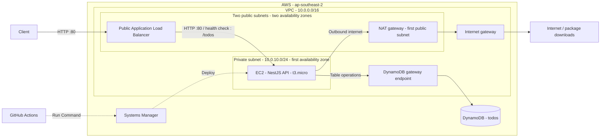
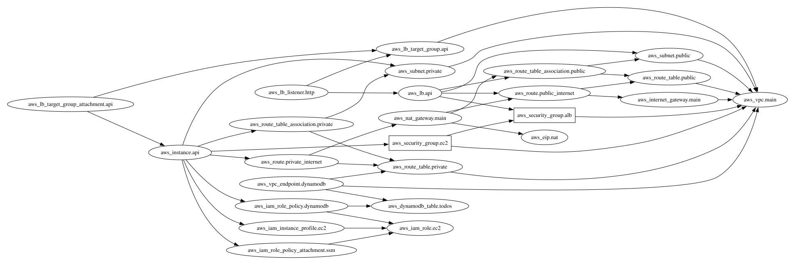

# Todo API

A REST API for creating, listing, updating, and deleting todos. Built with NestJS
and TypeScript, backed by Amazon DynamoDB, with Terraform infrastructure and a
GitHub Actions deployment workflow for AWS EC2.

Each todo has a UUID, a title, a completion flag, and creation/update timestamps.
The API validates requests, supports cursor-based pagination, and exposes a
health endpoint that does not query the database.

## Technology stack

| Area           | Tools                                              |
| -------------- | -------------------------------------------------- |
| Runtime        | Node.js 24, matching CI                            |
| Application    | NestJS 12, TypeScript 6, Express                   |
| Persistence    | DynamoDB, AWS SDK for JavaScript v3                |
| Validation     | `class-validator`, `class-transformer`             |
| Checks         | Vitest, Supertest, Oxlint                          |
| Infrastructure | Terraform, AWS VPC, ALB, EC2, IAM, Systems Manager |
| CI/CD          | GitHub Actions                                     |

## Local development

You need Node.js 24, npm, AWS credentials, and a DynamoDB table with a string
partition key named `id`. The Terraform configuration defines the `todos` table
in `ap-southeast-2`.

Install dependencies:

```sh
npm ci
```

Create a `.env` file in the repository root:

```dotenv
AWS_REGION=ap-southeast-2
DYNAMODB_TABLE_NAME=todos
PORT=3000
```

| Variable              | Required | Purpose                               |
| --------------------- | -------- | ------------------------------------- |
| `AWS_REGION`          | Yes      | Region containing the DynamoDB table. |
| `DYNAMODB_TABLE_NAME` | Yes      | Table used for todos.                 |
| `PORT`                | No       | HTTP port; defaults to `3000`.        |

The AWS SDK uses its default credential provider chain. For local development,
use a configured AWS profile or AWS credential environment variables. On EC2,
the application uses the attached instance role. Keep credentials out of source
control; `.env` is ignored by Git.

The application's AWS identity needs `dynamodb:PutItem`, `dynamodb:GetItem`,
`dynamodb:Scan`, `dynamodb:UpdateItem`, and `dynamodb:DeleteItem` on the configured
table. The EC2 policy is defined in [`infra/iam.tf`](infra/iam.tf). For local
development, grant equivalent permissions to your development identity. An
`AccessDeniedException` means the identity used by the SDK lacks the required
access.

Start the API with automatic reload:

```sh
npm run dev
```

The default base URL is `http://localhost:3000`. Check that it is running:

```sh
curl http://localhost:3000/health
```

Expected response: `{"status":"ok"}`. Todo operations also require access to the
configured DynamoDB table.

## API

| Method   | Route                           | Behavior                                                    | Success status |
| -------- | ------------------------------- | ----------------------------------------------------------- | -------------- |
| `GET`    | `/health`                       | Return application health without querying DynamoDB.        | `200`          |
| `POST`   | `/todos`                        | Create a todo from a `title`.                               | `201`          |
| `GET`    | `/todos?limit=10&cursor=<uuid>` | Return a page of todos. Both query parameters are optional. | `200`          |
| `GET`    | `/todos/:id`                    | Fetch one todo.                                             | `200`          |
| `PATCH`  | `/todos/:id`                    | Update `title`, `completed`, or both.                       | `200`          |
| `DELETE` | `/todos/:id`                    | Delete a todo; return an empty response.                    | `204`          |

### Create and update

Create a todo with this JSON body:

```json
{
  "title": "Document the architecture"
}
```

The response includes the generated UUID and UTC timestamps:

```json
{
  "id": "682bca13-9ad3-40cb-bbc8-b849807caaf5",
  "title": "Document the architecture",
  "completed": false,
  "createdAt": "2026-11-03T10:00:00.000Z",
  "updatedAt": "2026-11-03T10:00:00.000Z"
}
```

Use the returned `id` in subsequent requests. For example,
`PATCH /todos/682bca13-9ad3-40cb-bbc8-b849807caaf5` accepts:

```json
{
  "completed": true
}
```

`title` must be a non-empty string, and `completed` must be a boolean. Updates
must include at least one of those fields. IDs and pagination cursors must be
UUID v4 values. Unknown body or query fields are rejected. Invalid requests
return `400`; fetching, updating, or deleting a missing todo returns `404`.

### Pagination

`GET /todos` returns `{ "items": [...], "nextCursor": "<uuid>" }`.
The default `limit` is `10`; accepted values are integers from `1` to `100`.
Pass the returned `nextCursor` as the next request's `cursor`. A `null` cursor
means there are no more pages.

Listing uses a DynamoDB scan and does not guarantee item order.

## Development commands

| Command              | Purpose                                         |
| -------------------- | ----------------------------------------------- |
| `npm run dev`        | Run with automatic reload.                      |
| `npm start`          | Start through the Nest CLI.                     |
| `npm run build`      | Compile the application into `dist/`.           |
| `npm run start:prod` | Run the compiled application; build first.      |
| `npm run lint`       | Check application and test code with Oxlint.    |
| `npm run format`     | Format application and test TypeScript files.   |
| `npm test`           | Run the configured unit-test suite with Vitest. |
| `npm run test:e2e`   | Run the end-to-end test suite.                  |
| `npm run test:cov`   | Run unit tests with coverage.                   |

The current end-to-end test checks `/health` with the DynamoDB repository
replaced by a stub, so it does not require AWS access. There are currently no
unit-test files; `npm test` and `npm run test:cov` need unit tests to be added.

## System architecture

The Terraform configuration targets AWS in `ap-southeast-2`:



The detailed resource diagram below is generated directly from the Terraform
configuration in [`infra/`](infra/) using
[InfraMap](https://github.com/cycloidio/inframap) and
[Graphviz](https://graphviz.org/). [Open the full-size image](docs/architecture.svg)
to inspect individual resources. Arrows in this image indicate Terraform
dependencies; the system diagram above shows traffic and deployment paths.



| Component                 | Responsibility                                                                                                                                                                           |
| ------------------------- | ---------------------------------------------------------------------------------------------------------------------------------------------------------------------------------------- |
| VPC                       | `10.0.0.0/16`, with two public subnets in different availability zones and one private subnet (`10.0.10.0/24`) in the first zone.                                                        |
| Application Load Balancer | Accepts public HTTP on port `80` across both public subnets and forwards requests to EC2 on port `80`. Checks `/todos` for health.                                                       |
| EC2                       | One `t3.micro` instance hosts the API in the private subnet, with no public IP. Its security group accepts HTTP only from the ALB security group.                                        |
| DynamoDB                  | The `todos` table stores items with a string `id` partition key and on-demand billing. EC2 accesses it through a DynamoDB gateway VPC endpoint associated with the private route table.  |
| NAT and internet gateways | The private subnet routes outbound internet traffic through a NAT gateway in the first public subnet, then through the VPC internet gateway.                                             |
| IAM and deployment        | The EC2 instance profile grants access to the `todos` table and Systems Manager. The [GitHub Actions workflow](.github/workflows/ci-cd.yml) deploys through Systems Manager Run Command. |

Request path: **Client → public ALB → private EC2 API → DynamoDB gateway endpoint → `todos` table**.
The deployment uses a single EC2 instance; only the ALB spans two availability zones.

### Regenerate the diagram

Install [InfraMap v0.8.0](https://github.com/cycloidio/inframap/releases/tag/v0.8.0)
and [Graphviz](https://graphviz.org/download/), then run from the repository root:

```sh
inframap generate --hcl --raw --clean=false --show-icons=false ./infra | dot -Tsvg -Grankdir=LR -Gpad=0.25 -o docs/architecture.svg
```

Commit the updated image with changes to `infra/*.tf`. Generation reads the local
Terraform source and does not require AWS credentials or a Terraform deployment.
`--raw` preserves IAM, routing, and VPC endpoint resources. Counted resources
appear as a single resource block in the generated graph. Update the system
overview above when changing runtime traffic or deployment paths.

## Infrastructure and deployment

The [`infra/`](infra/) directory defines networking, EC2, IAM, the load balancer,
and DynamoDB. It requires Terraform `>= 1.6.0, < 2.0.0`, the AWS provider `~> 6.0`,
and an AWS identity with permission to manage those resources.

Review and provision the infrastructure from the repository root:

```sh
terraform -chdir=infra init
terraform -chdir=infra plan
terraform -chdir=infra apply
```

If the `todos` table already exists in the target account and region and is not
in this Terraform state, import it before applying:

```sh
terraform -chdir=infra import aws_dynamodb_table.todos todos
```

Terraform outputs `api_url`, `instance_id`, `private_ip`, and `table_name`.
The EC2 resource does not configure Node.js, the application process, or the
deployment helper. Prepare the instance with the application environment,
the SSM agent, and `/usr/local/bin/deploy-todo-api`. The application must be
reachable on EC2 port `80`, either directly or through a reverse proxy, to match
the ALB target group; local development defaults to port `3000`.

The [CI/CD workflow](.github/workflows/ci-cd.yml) installs dependencies, lints,
and builds on pull requests and pushes to `main`. Its test step is currently
commented out. After CI succeeds, pushes to `main` and manual runs on `main`
deploy through Systems Manager Run Command.

Configure these GitHub repository settings:

| Setting                 | Type     | Purpose                                                   |
| ----------------------- | -------- | --------------------------------------------------------- |
| `AWS_ACCESS_KEY_ID`     | Secret   | AWS identity used by the deployment workflow.             |
| `AWS_SECRET_ACCESS_KEY` | Secret   | Secret key for that identity.                             |
| `EC2_INSTANCE_ID`       | Variable | Target EC2 instance, available from the Terraform output. |

The deployment identity must be able to send SSM commands to the instance and
read their results. The workflow invokes
`/usr/local/bin/deploy-todo-api <commit-sha>` on the instance and waits for its
result. That helper script is not included in this repository.

## Project structure

```text
src/
  main.ts                    Application bootstrap and request validation
  app.controller.ts          GET /health
  modules/todos/
    dtos/                    Request validation
    todo.controller.ts       Todo HTTP routes
    todo.service.ts          Todo operations and not-found handling
    todo.repository.ts       DynamoDB operations and pagination
test/                        End-to-end tests
infra/                       Terraform infrastructure
docs/architecture.svg        Generated Terraform resource diagram
.github/workflows/ci-cd.yml   CI and EC2 deployment
```
